# Diagramas C4 - Sistema de Facturación SOANDES

Diagramas arquitectónicos según el modelo C4 (Context, Container, Component, Code), más diagramas de flujo de las reglas de negocio clave.
Notación: [Mermaid](https://mermaid.js.org/), que se renderiza en GitHub/GitLab y VS Code.

> **Última actualización:** 2026-10-10 (specs 001–015). Texto complementario en la [Documentación Técnica](TECHNICAL_DOCUMENTATION.md).

---

## Nivel 1: Diagrama de Contexto

El sistema y sus interacciones con actores y sistemas externos.

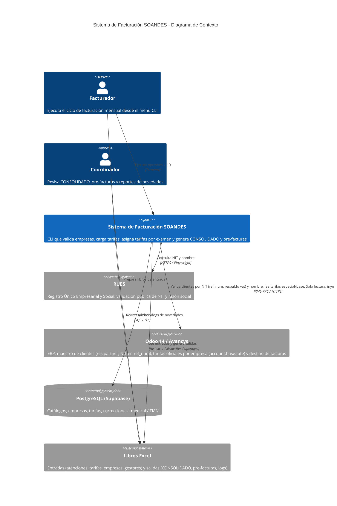

---

## Nivel 2: Diagrama de Contenedores

Las piezas técnicas principales del sistema.

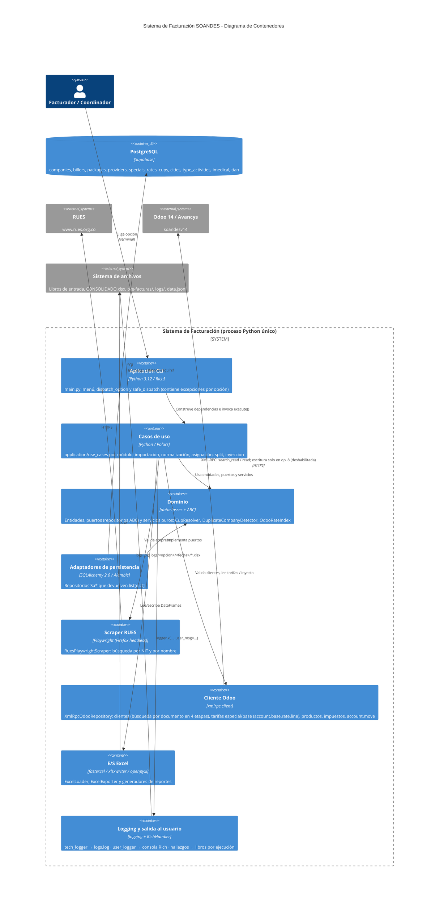

---

## Nivel 3: Diagrama de Componentes

Módulos de negocio, la opción del menú que atiende cada uno y sus dependencias compartidas.

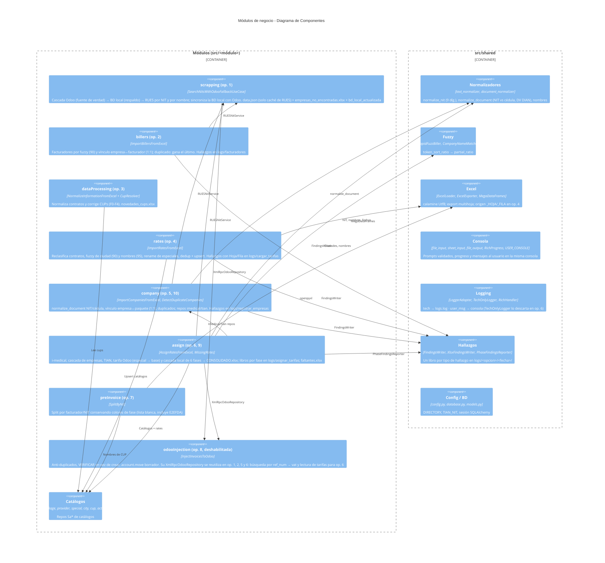

---

## Nivel 4: Diagrama de Código (Módulo Assign)

El módulo más complejo: la asignación de tarifas (opción 6).

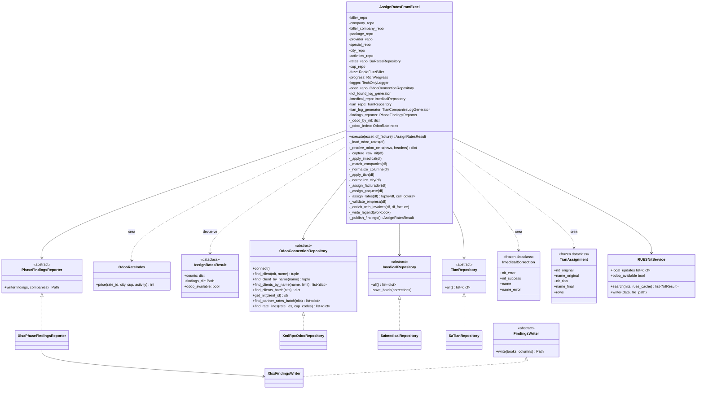

---

## Nivel 4: Diagrama de Código (Módulo Scrapping)

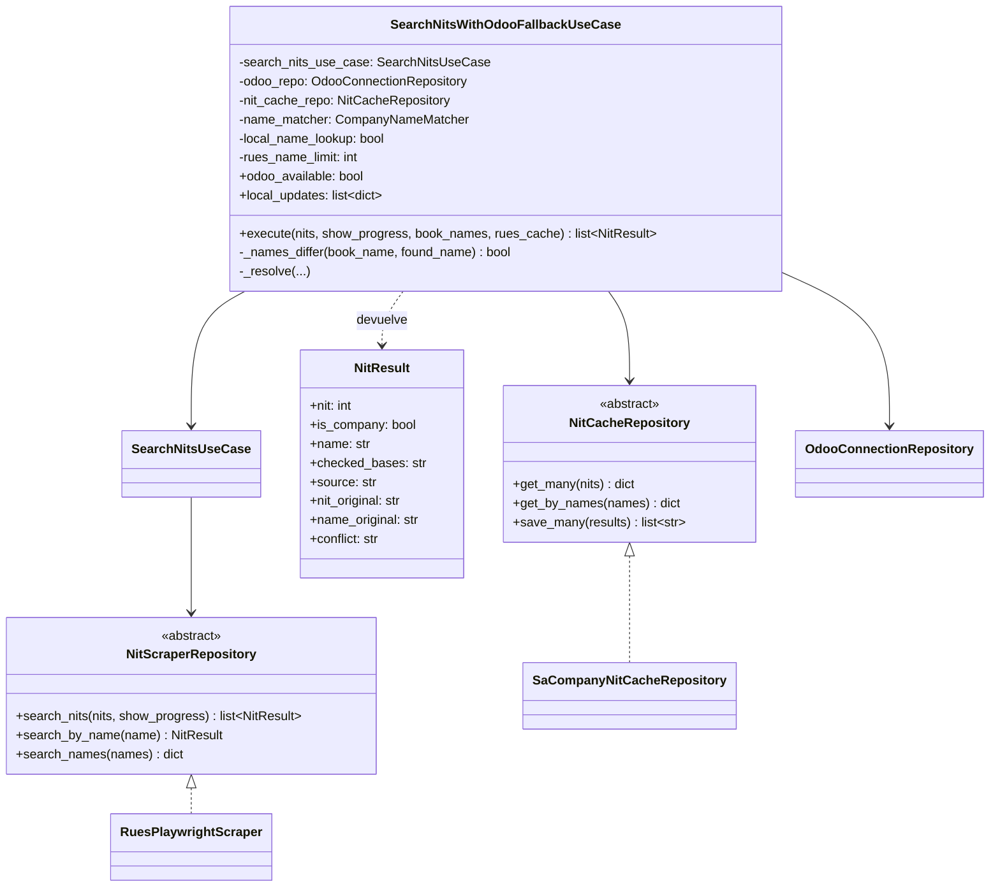

---

## Nivel 4: Diagrama de Código (Módulo OdooInjection)

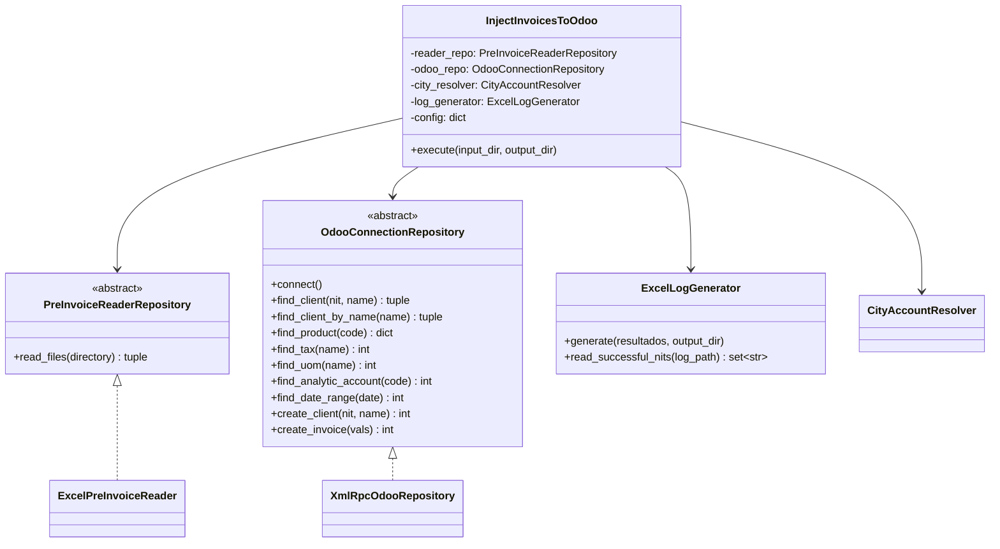

> `create_client` existe en el puerto, pero el caso de uso nunca lo invoca (ADR-010, "verificar, nunca crear"). Solo llena `vat`, mientras Odoo guarda el NIT en `ref_num`: la spec 012 encontró 54 clientes duplicados creados así. `find_client` delega en `find_clients_batch([nit])`. La opción 8 está deshabilitada en `main.py`.

---

## Flujo: Cascada de validación de empresas (opción 1)

**Odoo es la fuente de verdad** (spec 016): se consulta primero y siempre, también para las empresas que ya están en la BD local. La BD local es el respaldo y se corrige con lo que dice Odoo. `data.json` solo aporta resultados de RUES. Cada paso recibe solo lo que el anterior dejó pendiente. Las opciones 2 y 5 usan la misma cascada (`RUESNitService`); la opción 6 valida sus empresas en el mismo orden con su propia lógica.

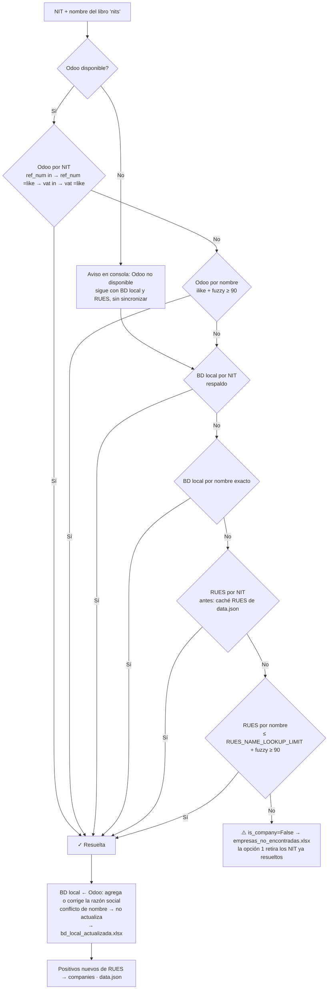

## Flujo: Pipeline de Asignar Tarifas (opción 6)

```mermaid
flowchart TD
    IN[Libro de atenciones] --> RAW[_capture_raw_nit<br/>NIT crudo sin truncar]
    RAW --> IM{NIT crudo en imedical?}
    IM -->|Sí| IMC[Reemplaza por nit_success<br/>y bloquea cambios por nombre]
    IM -->|No| N9
    IMC --> N9[normalize_nit → 9 dígitos]
    N9 --> MC[_match_companies<br/>Odoo NIT → Odoo nombre → BD NIT → BD nombre → RUES NIT → RUES nombre]
    MC --> AUTO{Base=IMEDICAL y Odoo<br/>da otro NIT con nombre ≥ 90?}
    AUTO -->|Sí| SAVE[Auto-registro en imedical]
    AUTO -->|No| UNI
    SAVE --> UNI[Unificar nombre por NIT<br/>Odoo > BD > primero visto]
    UNI --> NORM[_normalize_columns<br/>fechas, sufijos, INTRA/EXTRA]
    NORM --> TIAN{NIT en tabla tian<br/>y TIAN_NIT válido?}
    TIAN -->|Sí| TR[Factura a TIAN_NIT · nombre '...TIAN' · empresas_tian.xlsx]
    TIAN -->|No| CITY
    TR --> CITY[_normalize_city fuzzy ≥ 90]
    CITY --> OD["_load_odoo_rates<br/>find_partner_rates_batch + find_rate_lines → OdooRateIndex<br/>Odoo no disponible → índice vacío"]
    OD --> FB["Facturador desde BD, default GENERAL<br/>PAQUETE = tarifa especial Odoo › base › paquete local, default PAQUETE C 2025"]
    FB --> RATES["Tarifa Odoo especial → base<br/>luego cascada local de 6 fases"]
    RATES --> INV{¿día fuera de<br/>DAY_INITIAL–DAY_FINAL?}
    INV -->|Sí| FAC[Cruce con libro de facturas → FACTURAS]
    INV -->|No| OUT
    FAC --> OUT["CONSOLIDADO.xlsx + hoja Leyenda<br/>+ logs/asignar_tarifas/fecha/ + tabla resumen Rich"]
```

## Flujo: Cascada de tarifas (`_assign_rates`)

Por cada celda CUP con valor `1`:

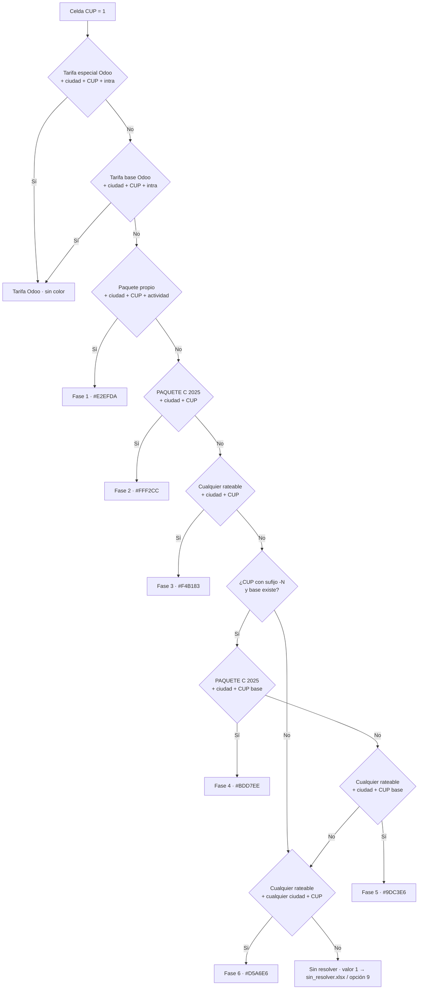

> Las fases 3, 5 y 6 toman la primera fila que devuelve la BD (consulta sin `ORDER BY`). Odoo: solo precios > 0, sin validar la vigencia de la tarifa; la ciudad se compara por nombre normalizado exacto. Cada fase local (1–6) y el sin resolver van a su libro en `logs/asignar_tarifas/<fecha>/`.

## Flujo: Inyección a Odoo (opción 8, deshabilitada)

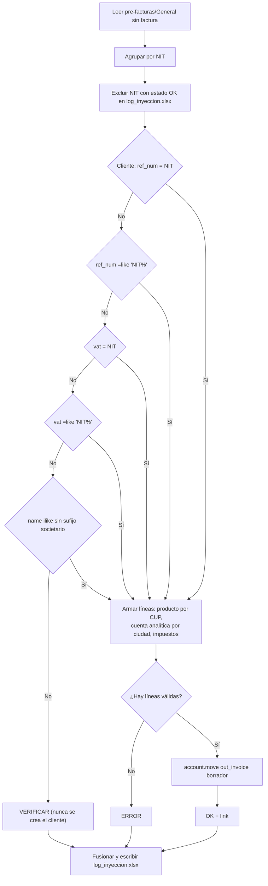

---

## Diagrama de Flujo de Datos (ciclo mensual)

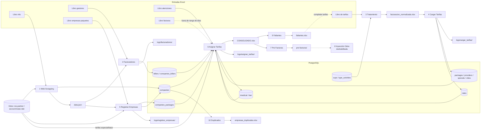

---

## Diagrama de Despliegue

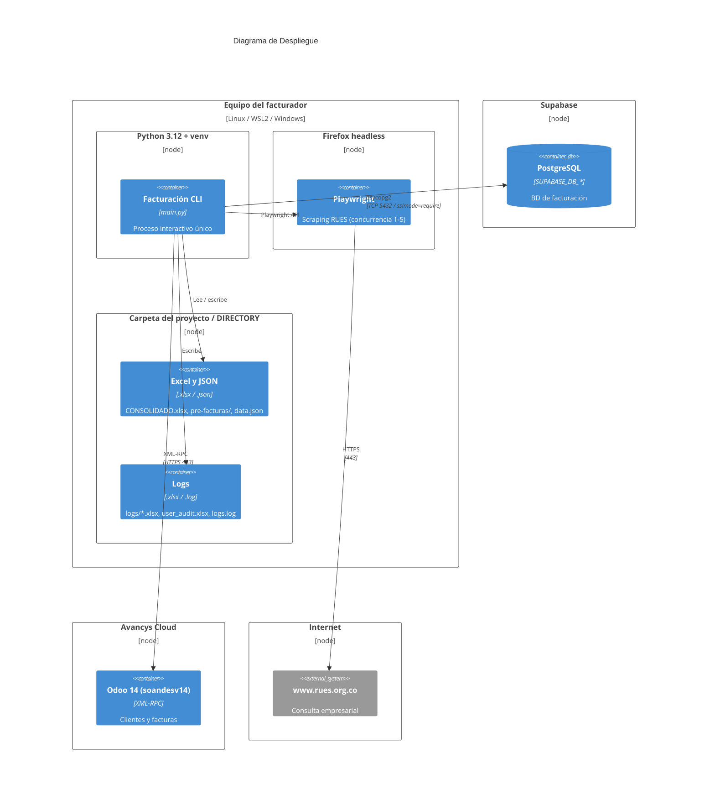

> Alembic usa `DATABASE_URL` si está definida (si no, `SUPABASE_DB_*` con puerto por defecto 6543). La aplicación usa siempre `SUPABASE_DB_*` (puerto por defecto 5432).

---

## Cómo renderizar los diagramas

Los diagramas se renderizan automáticamente en:

- GitHub / GitLab
- VS Code con la extensión "Markdown Preview Mermaid Support"
- [mermaid.live](https://mermaid.live)

Para generar imágenes estáticas:

```bash
npm install -g @mermaid-js/mermaid-cli
mmdc -i docs/c4-diagrams.md -o docs/diagrams/c4.png
```
