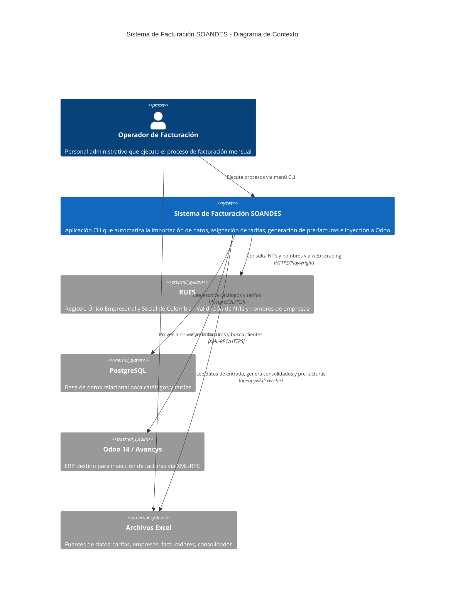
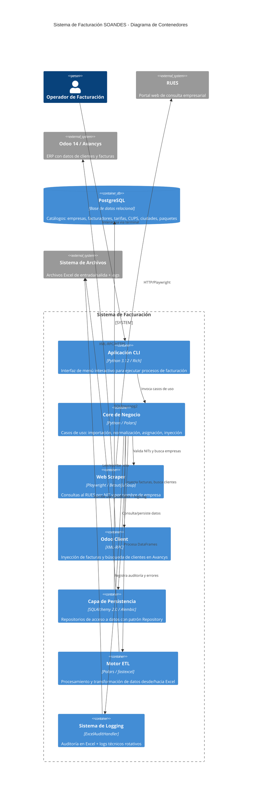
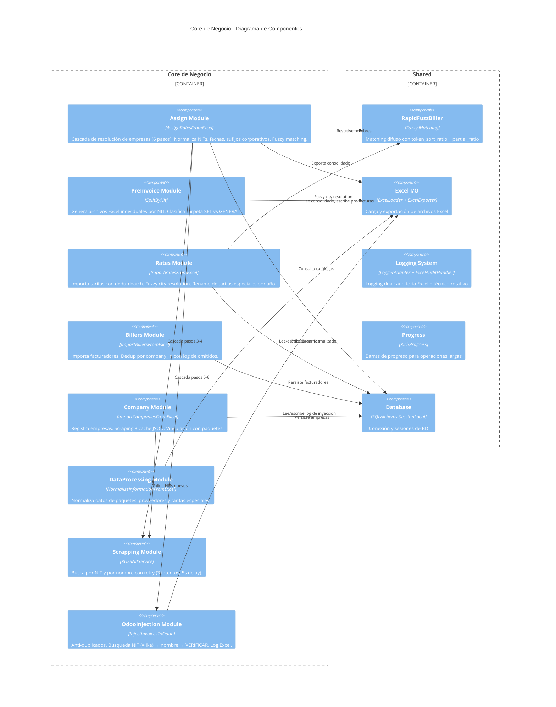
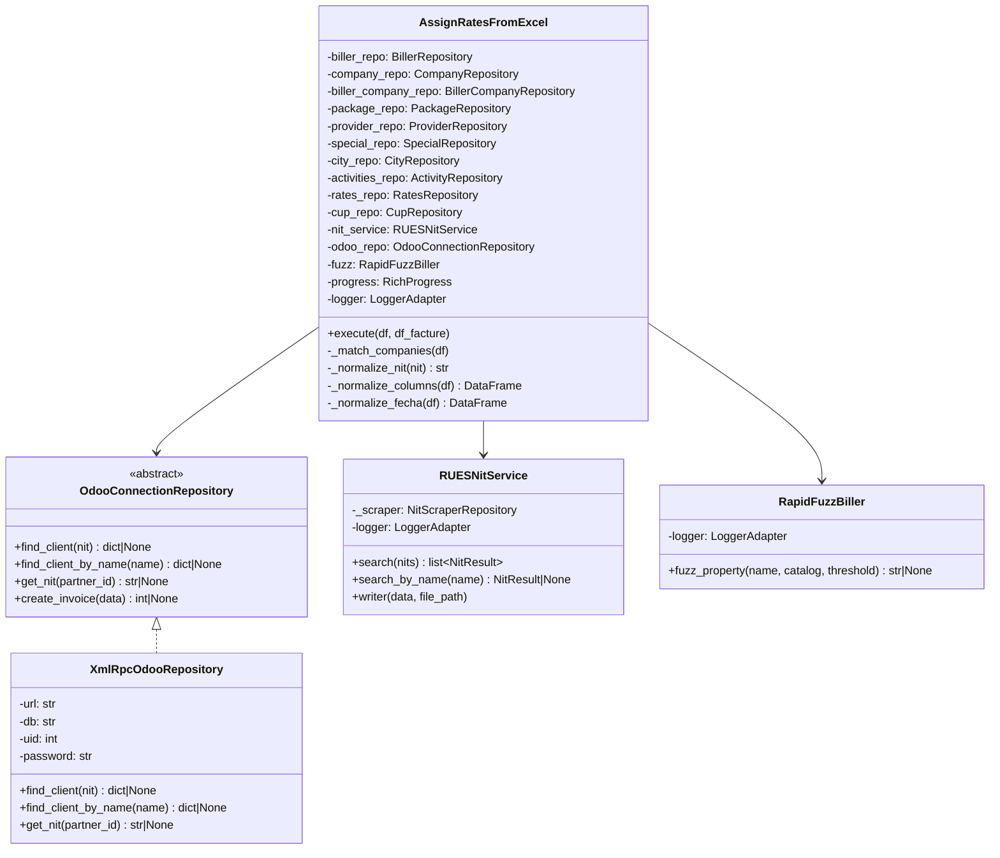
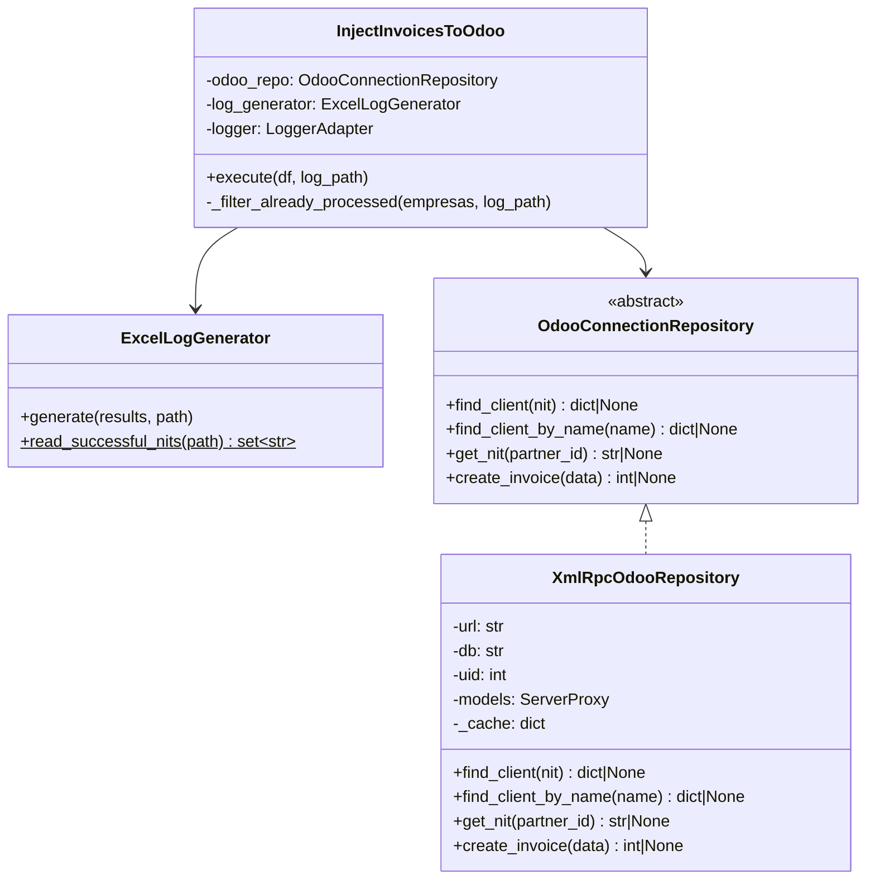
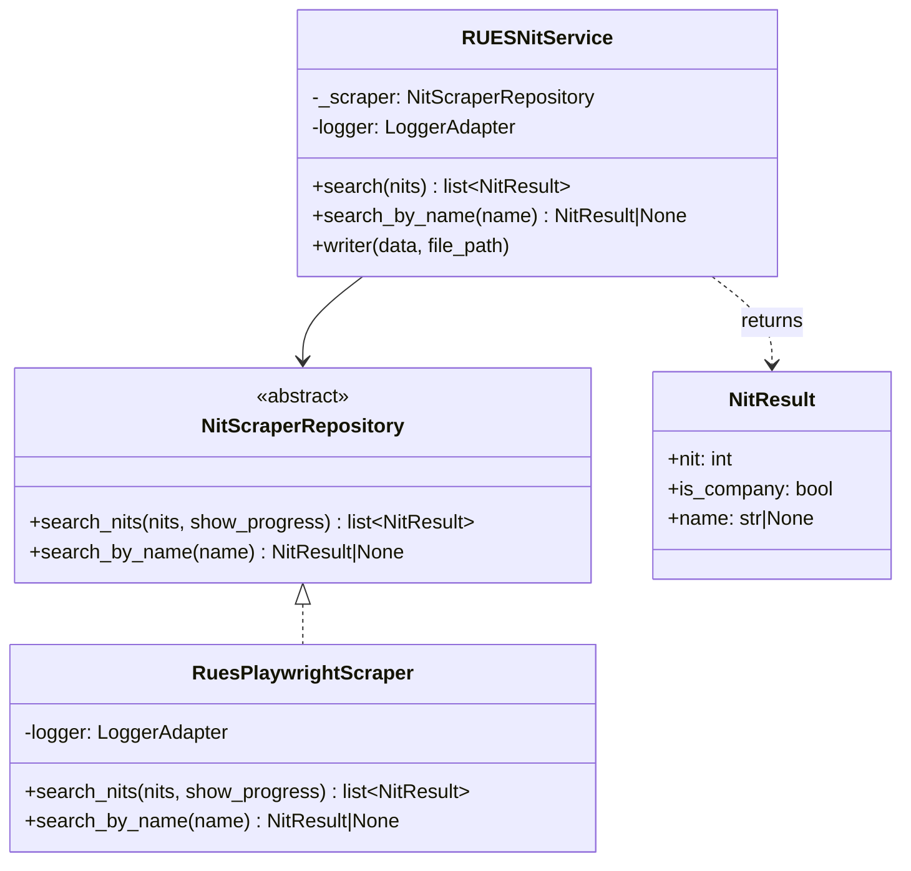
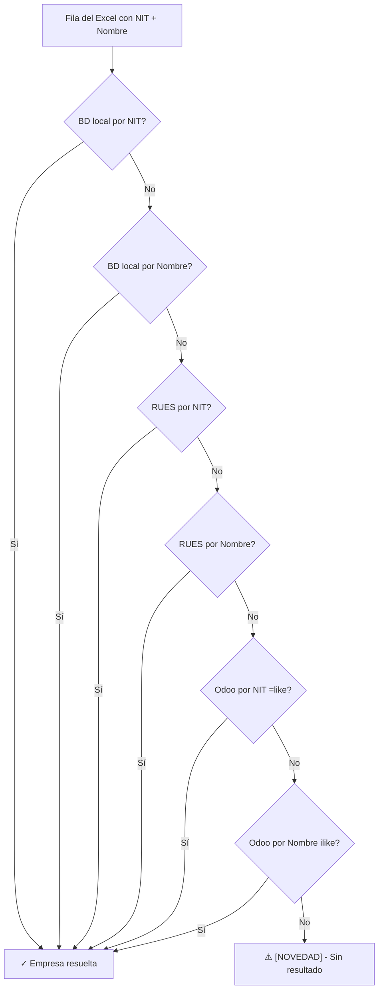
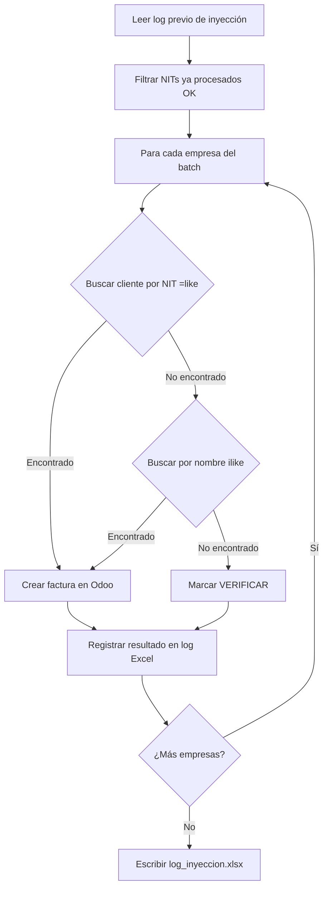
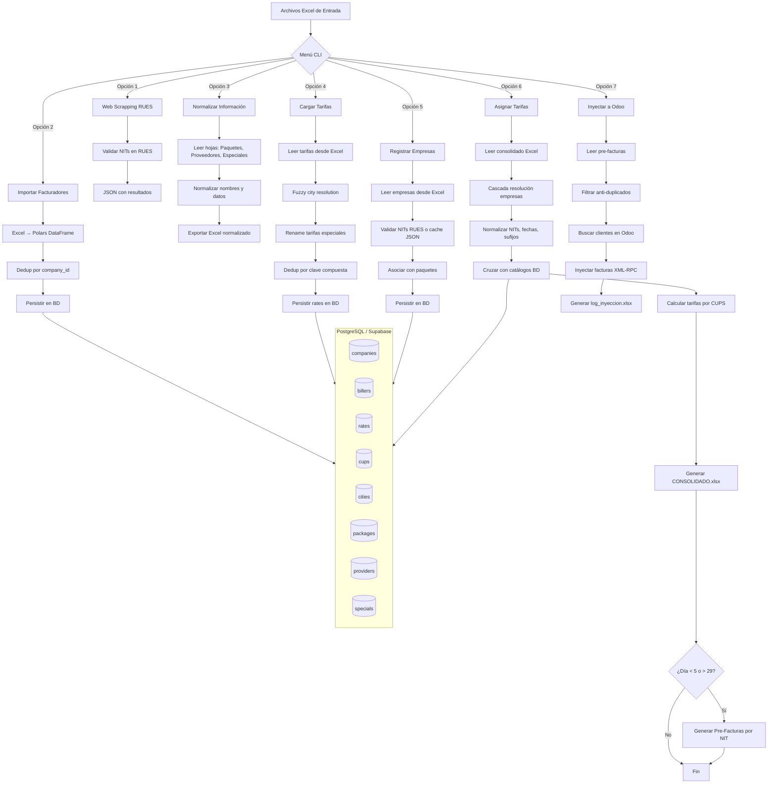
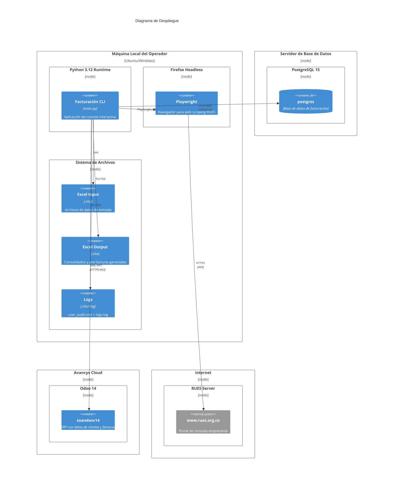

# Diagramas C4 - Sistema de Facturación SOANDES

Diagramas arquitectónicos siguiendo el modelo C4 (Context, Container, Component, Code).
Notación: [Mermaid](https://mermaid.js.org/) para renderizado en GitHub/GitLab.

---

## Nivel 1: Diagrama de Contexto

Muestra el sistema y sus interacciones con actores y sistemas externos.



---

## Nivel 2: Diagrama de Contenedores

Muestra los componentes técnicos principales del sistema.



---

## Nivel 3: Diagrama de Componentes

Detalle de los módulos internos del Core de Negocio.



---

## Nivel 4: Diagrama de Código (Módulo Assign)

Detalle del módulo más complejo: asignación de tarifas.



---

## Nivel 4: Diagrama de Código (Módulo OdooInjection)



---

## Nivel 4: Diagrama de Código (Módulo Scrapping)



---

## Diagrama de Flujo: Cascada de Resolución de Empresas



---

## Diagrama de Flujo: Inyección a Odoo



---

## Diagrama de Flujo de Datos



---

## Diagrama de Despliegue



---

## Cómo Renderizar los Diagramas

Los diagramas están escritos en **Mermaid** y se renderizan automáticamente en:
- GitHub (README, issues, PRs)
- GitLab
- VS Code con extensión "Mermaid Preview"
- [mermaid.live](https://mermaid.live) (editor online)

Para generar imágenes estáticas:
```bash
npm install -g @mermaid-js/mermaid-cli
mmdc -i docs/c4-diagrams.md -o docs/diagrams/ -e png
```
